# Smart-PJU — Adaptive Smart Street Lighting Dashboard Monitoring

Sistem monitoring dan manajemen Penerangan Jalan Umum Pintar (Smart PJU) berbasis web menggunakan framework **Laravel**. Sistem ini dirancang untuk memantau kondisi operasional lampu PJU secara real-time, mendeteksi anomali/gangguan, mengontrol intensitas pencahayaan secara adaptif guna efisiensi energi, serta mengelola tiket tindak lanjut teknisi.

---

## 📋 Daftar Kebutuhan Fungsional (Functional Requirements)

Berikut adalah daftar kebutuhan fungsional sistem yang menjadi acuan utama pengembangan:

| ID | Kebutuhan Fungsional | Deskripsi |
| :--- | :--- | :--- |
| **KF-01** | **Autentikasi pengguna** | Sistem menyediakan login dan logout bagi pengguna yang terdaftar serta membatasi akses berdasarkan perannya (Admin, Operator, Teknisi). |
| **KF-02** | **Pengelolaan data lampu** | Pengelola dapat menambahkan, melihat, mengubah, dan menonaktifkan data lampu yang mencakup kode lampu, lokasi (koordinat GIS), serta identitas perangkat pengendali (Controller ID / Node ID). |
| **KF-03** | **Pembacaan dan pengiriman data sensor** | Perangkat membaca kondisi cahaya (lux), deteksi aktivitas (PIR/radar), serta parameter kelistrikan (tegangan, arus, daya, kWh), lalu mengirimkannya via komunikasi radio estafet (mesh) ke Gateway hingga masuk ke sistem. |
| **KF-04** | **Pengendalian berdasarkan cahaya** | Perangkat menyalakan lampu ketika gelap dan mematikannya ketika terang dengan ambang batas (threshold hysteresis) untuk mencegah nyala-mati berulang. |
| **KF-05** | **Pengaturan intensitas adaptif** | Perangkat meredupkan lampu (misal 30%) ketika tidak ada aktivitas, dan meningkatkan intensitas (100%) ketika aktivitas terdeteksi. |
| **KF-06** | **Pengaturan parameter operasi** | Pengelola dapat mengubah periode hemat energi, setelan redup/terang, dan ambang cahaya dari dashboard web secara sentral atau per grup/zona. |
| **KF-07** | **Monitoring kondisi lampu** | Sistem menampilkan lokasi pada peta digital interaktif, mode operasi, setelan intensitas, pembacaan sensor realtime, dan waktu pembaruan terakhir. |
| **KF-08** | **Deteksi indikasi gangguan** | Sistem mendeteksi gangguan ketika lampu diperintahkan ON tetapi pembacaan arus berada di bawah ambang normal (misal 0A menandakan lampu putus/rusak). |
| **KF-09** | **Deteksi perangkat offline** | Sistem menandai perangkat sebagai offline (Lost Communication) apabila tidak ada data telemetri yang diterima dalam batas waktu tertentu (*heartbeat timeout*). |
| **KF-10** | **Notifikasi gangguan** | Sistem mengirimkan notifikasi instan berisi kode lampu, lokasi, waktu kejadian, dan jenis gangguan kepada grup teknisi terkait. |
| **KF-11** | **Riwayat operasional** | Sistem menyimpan riwayat pembacaan sensor (telemetri log) dan perubahan konfigurasi berdasarkan rentang waktu untuk kebutuhan audit dan analisis. |
| **KF-12** | **Pencatatan tindak lanjut** | Teknisi dapat mencatat pemeriksaan lapangan, tindakan perbaikan, pergantian komponen, dan status penanganan tiket gangguan (*Open / In Progress / Resolved*). |
| **KF-13** | **Rekapitulasi konsumsi energi** | Sistem menampilkan estimasi penghematan energi (kWh & estimasi biaya) dari hasil penerapan mode adaptif dibandingkan mode konvensional (selalu terang). |

---

## 🔄 Sequence Diagram Kebutuhan Fungsional (KF-01 s/d KF-13)

Berikut adalah visualisasi alur interaksi sistem (sequence diagram) berbasis **Mermaid** untuk setiap kebutuhan fungsional. Diagram ini otomatis dirender secara grafis di GitHub, GitLab, VS Code, dan Antigravity IDE.

**Navigasi Cepat:**
[KF-01](#kf-01-autentikasi-pengguna) • [KF-02](#kf-02-pengelolaan-data-lampu) • [KF-03](#kf-03-pembacaan-dan-pengiriman-data-sensor) • [KF-04](#kf-04-pengendalian-berdasarkan-cahaya) • [KF-05](#kf-05-pengaturan-intensitas-adaptif) • [KF-06](#kf-06-pengaturan-parameter-operasi) • [KF-07](#kf-07-monitoring-kondisi-lampu) • [KF-08](#kf-08-deteksi-indikasi-gangguan) • [KF-09](#kf-09-deteksi-perangkat-offline) • [KF-10](#kf-10-notifikasi-gangguan) • [KF-11](#kf-11-riwayat-operasional) • [KF-12](#kf-12-pencatatan-tindak-lanjut) • [KF-13](#kf-13-rekapitulasi-konsumsi-energi)

---

### KF-01: Autentikasi Pengguna
*Sistem menyediakan login dan logout bagi pengguna terdaftar serta membatasi akses berdasarkan perannya.*

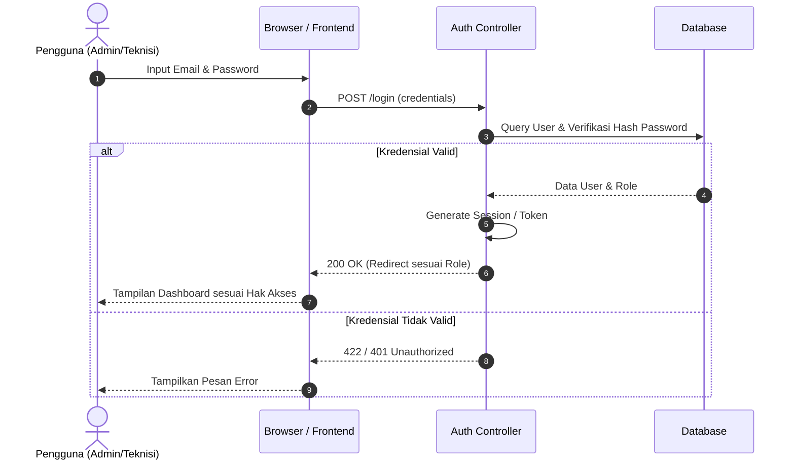

---

### KF-02: Pengelolaan Data Lampu
*Pengelola dapat menambahkan, melihat, mengubah, dan menonaktifkan data lampu (kode lampu, lokasi GIS, Controller ID).*

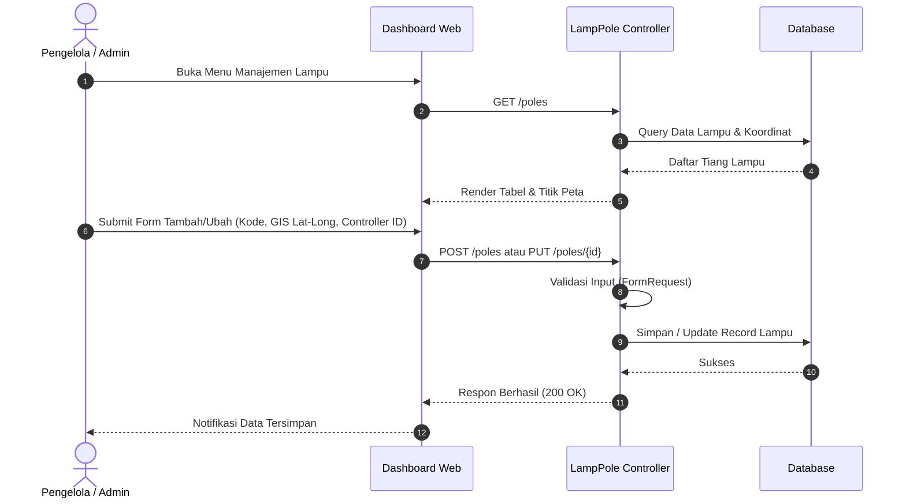

---

### KF-03: Pembacaan dan Pengiriman Data Sensor
*Perangkat membaca kondisi cahaya, aktivitas, dan listrik, lalu mengirim via radio estafet (mesh) ke Gateway hingga ke sistem.*

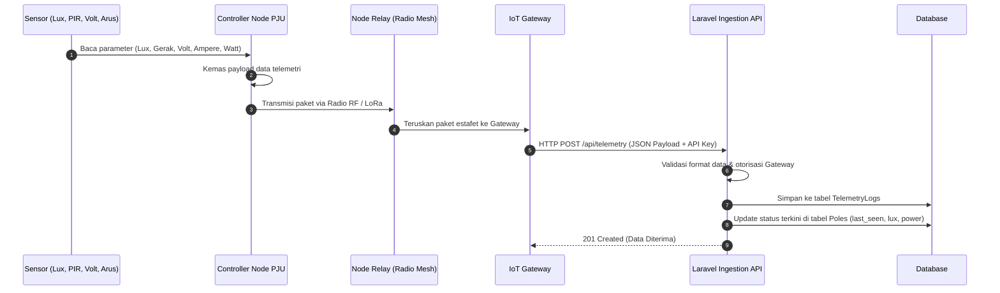

---

### KF-04: Pengendalian Berdasarkan Cahaya
*Perangkat menyalakan lampu ketika gelap dan mematikan ketika terang dengan ambang batas histeresis.*

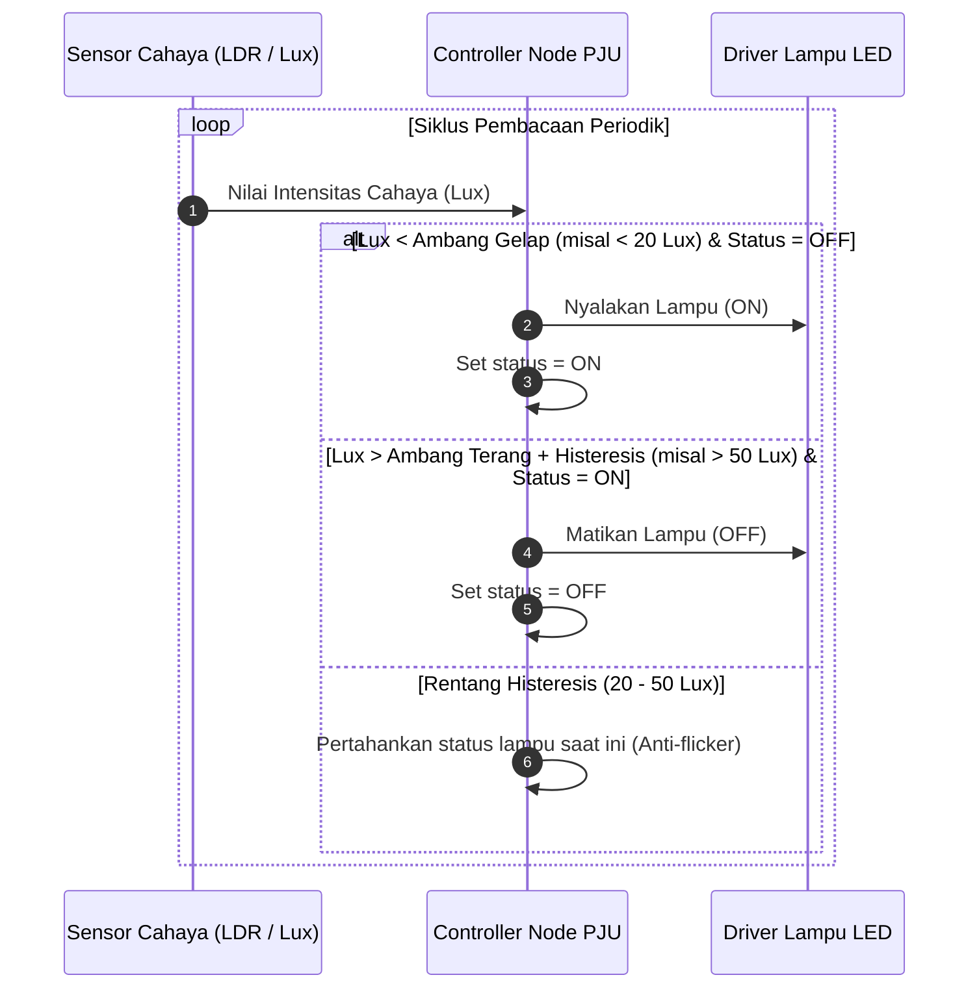

---

### KF-05: Pengaturan Intensitas Adaptif
*Perangkat meredupkan lampu (misal 30%) saat tidak ada aktivitas, dan meningkatkan ke 100% saat aktivitas terdeteksi.*

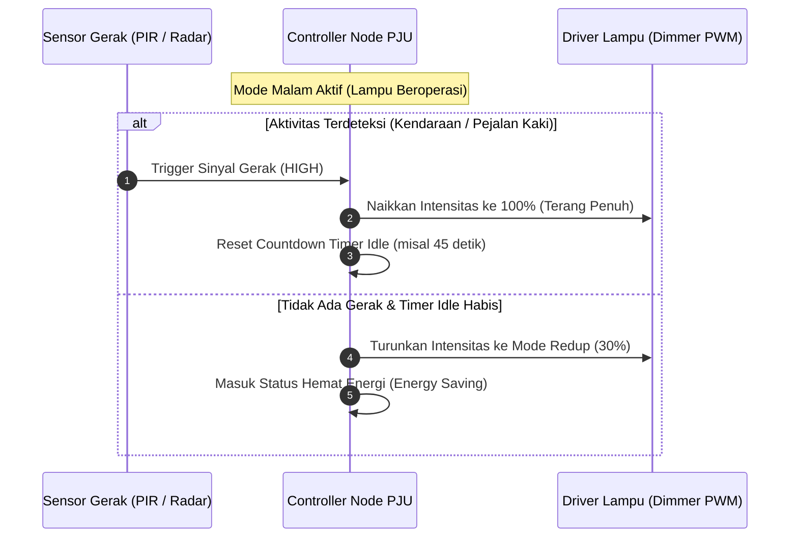

---

### KF-06: Pengaturan Parameter Operasi
*Pengelola dapat mengubah periode hemat energi, setelan redup/terang, dan ambang cahaya dari dashboard web.*

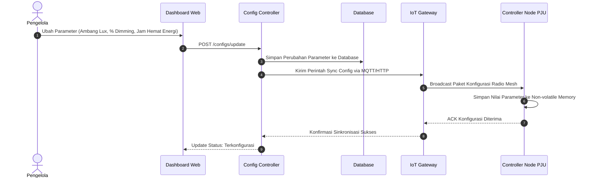

---

### KF-07: Monitoring Kondisi Lampu
*Sistem menampilkan lokasi, mode operasi, setelan intensitas, pembacaan sensor, dan waktu pembaruan terakhir.*

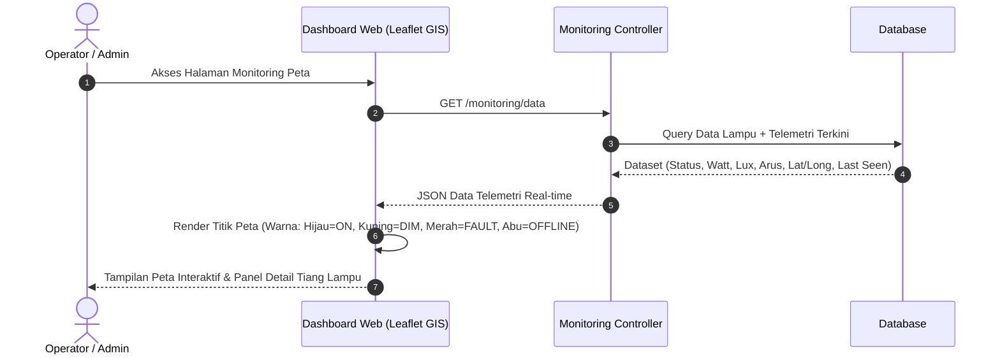

---

### KF-08: Deteksi Indikasi Gangguan
*Sistem mendeteksi gangguan saat lampu diperintahkan ON tetapi pembacaan arus di bawah ambang normal (misal 0A).*

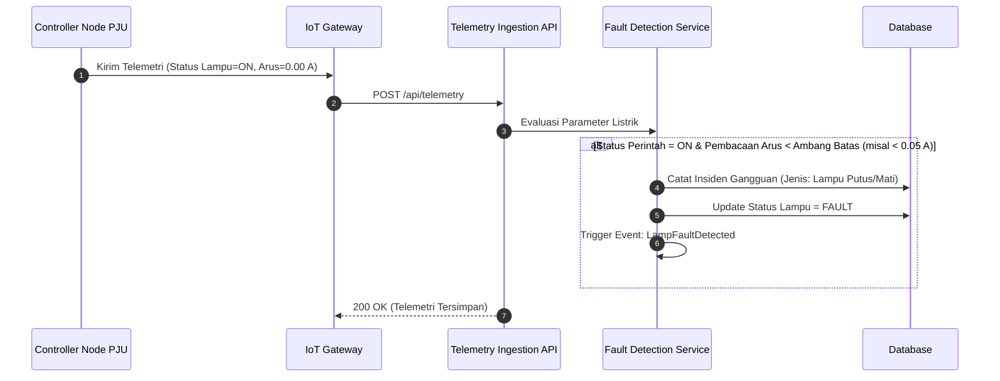

---

### KF-09: Deteksi Perangkat Offline
*Sistem menandai perangkat sebagai offline apabila tidak ada data yang diterima dalam batas waktu tertentu.*

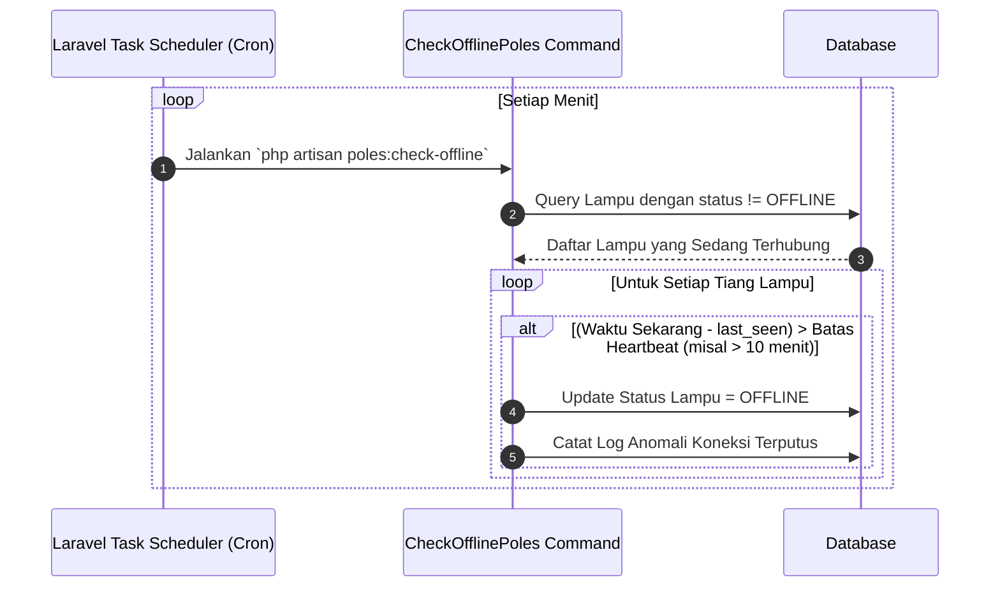

---

### KF-10: Notifikasi Gangguan
*Sistem mengirimkan notifikasi instan berisi kode lampu, lokasi, waktu, dan jenis gangguan kepada grup teknisi.*

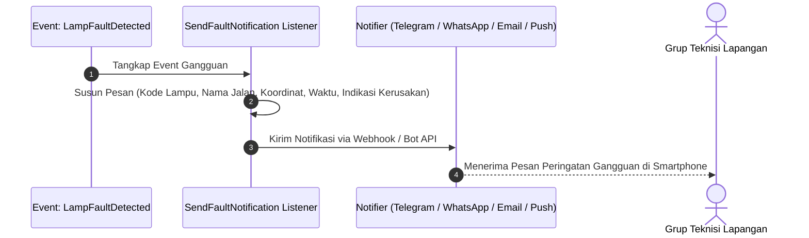

---

### KF-11: Riwayat Operasional
*Sistem menyimpan riwayat pembacaan sensor dan perubahan konfigurasi berdasarkan rentang waktu.*

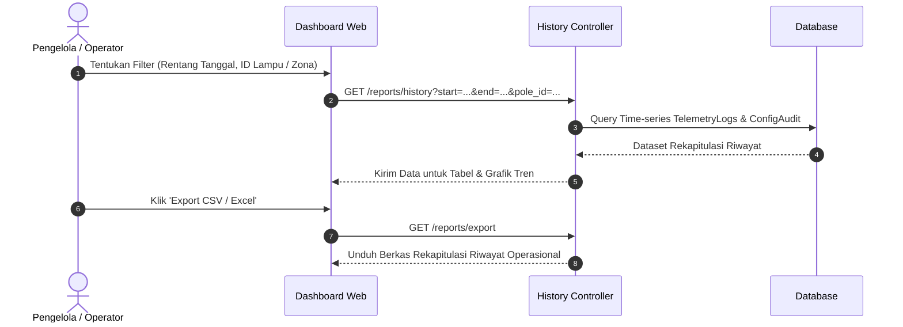

---

### KF-12: Pencatatan Tindak Lanjut
*Teknisi dapat mencatat pemeriksaan, tindakan perbaikan, dan status penanganan tiket gangguan (Open/Resolved).*

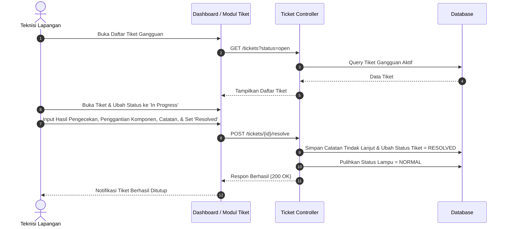

---

### KF-13: Rekapitulasi Konsumsi Energi
*Sistem menampilkan estimasi penghematan energi dari mode adaptif dibandingkan mode selalu terang.*

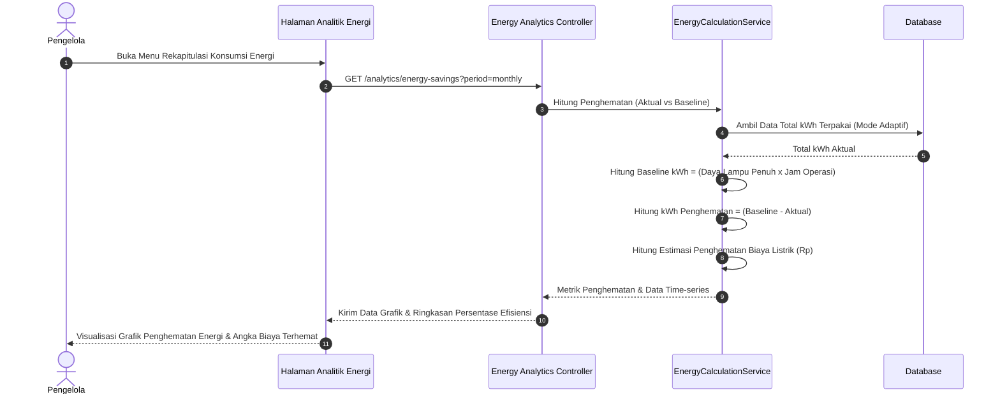

---

## 🤖 Aturan Baku untuk AI Coding Agent (AI Agent Guidelines)

Bagi seluruh anggota tim yang menggunakan AI Coding Agent (seperti **Antigravity**, **Claude Code**, **Cursor**, **GitHub Copilot**, atau tools AI lainnya), setiap AI Agent **WAJIB** mematuhi aturan berikut saat membaca, memodifikasi, atau menambahkan kode:

### 1. Fondasi & Standar Kode PHP (PHP 8.3 & Laravel 11+)
- **Laravel Way:** Selalu gunakan perintah resmi `php artisan make:*` untuk membuat komponen baru (Controller, Model, Migration, Seeder, Request, Event, Job, Resource, dll.).
- **Strict Typing:** Selalu gunakan `declare(strict_types=1);` jika relevan, gunakan type hint eksplisit pada parameter fungsi dan return type:
  ```php
  public function updateThreshold(Pole $pole, float $luxThreshold): bool
  ```
- **Constructor Property Promotion:** Gunakan fitur PHP 8:
  ```php
  public function __construct(
      public readonly TelemetryService $telemetryService,
  ) {}
  ```
- **Kontrol Alur:** Selalu gunakan kurung kurawal `{}` untuk semua blok kontrol (`if`, `foreach`, `while`), hindari single-line tanpa kurung kurawal.
- **Validasi:** Selalu gunakan Form Request (`php artisan make:request`) untuk validasi input form atau API payload, jangan menuliskan validasi panjang di dalam Controller.
- **RESTful API:** Gunakan Eloquent API Resource (`php artisan make:resource`) untuk memformat respon JSON endpoint IoT atau mobile.

### 2. Struktur Database & Model
- **Dilarang manipulasi DB langsung:** Jangan membuat/mengubah tabel manual di database manager. Selalu buat file **Migration** yang rapi dan idempotent.
- **Factory & Seeder:** Setiap pembuatan Model baru harus disertai **Factory** dan **Seeder** data dummy realistis (termasuk simulasi data koordinat GPS, telemetri sensor, dan riwayat gangguan).
- **Relasi & Query Optimization:** Wajib memperhatikan potensi isu *N+1 query*. Selalu gunakan Eager Loading (`with(['telemetries', 'pole'])`).
- **Data Casting & Enums:** Gunakan PHP Enums atau Eloquent Attribute Casting untuk status penting (contoh: status lampu `ON`, `OFF`, `FAULT`, status tiket `OPEN`, `RESOLVED`).

### 3. Arsitektur Folder & Dependensi
- **Patuhi Struktur Eksisting:** Dilarang membuat folder baru di root direktori tanpa persetujuan tim. Ikuti struktur bawaan Laravel (`app/Models`, `app/Http/Controllers`, `app/Services`, `routes/web.php`, `routes/api.php`).
- **Logika Bisnis:** Tempatkan logika perhitungan rumit (seperti kalkulasi penghematan energi KF-13 atau pemrosesan paket radio KF-03) pada lapisan **Service Class** (`app/Services/`), bukan menumpuk di Controller atau Blade.
- **Tidak Mengubah Dependensi Sembarangan:** Jangan menambahkan library eksternal baru (`composer require` atau `npm i`) tanpa konfirmasi kebutuhan teknisnya.

### 4. Frontend & Antarmuka
- **Desain Modern & Responsif:** Tampilan dashboard harus bersih, elegan, bertema modern (*dark mode friendly* atau palet warna terkurasi khas IoT/smart city), dan mudah diakses di perangkat tablet/smartphone teknisi lapangan.
- **Aset & Build:** Gunakan Vite (`npm run dev` / `npm run build`). Pastikan ID elemen interaktif jelas untuk memudahkan pengujian otomatis.

### 5. Pengujian & Quality Assurance
- **Unit & Feature Test:** Setiap penambahan fitur baru (khususnya logika KF-01 s/d KF-13) wajib disertai Feature Test menggunakan PHPUnit/Pest:
  ```bash
  php artisan test
  ```
- **Linter & Code Formatter:** Sebelum membuat commit atau mengajukan pull request, AI Agent dan pengembang wajib menjalankan Laravel Pint:
  ```bash
  vendor/bin/pint --format agent
  ```
- **Hindari Script Coba-Coba:** Jangan meninggalkan file script sementara atau file tes manual di folder publik.

### 6. Git & Commit Workflow
- Gunakan format **Conventional Commits**:
  - `feat(kf-02): add lamp pole management CRUD`
  - `feat(kf-08): implement current fault detection logic`
  - `fix(kf-09): resolve heartbeat timeout calculation`
  - `test(kf-04): add tests for lux-based threshold switching`
  - `docs: update deployment and architecture documentation`

---

## 🚀 Panduan Memulai (Quick Start)

### Prasyarat Sistem
- **PHP:** Versi `>= 8.3` (dengan ekstensi `pdo_mysql`, `mbstring`, `curl`, `openssl`, `zip`)
- **Database Server:** **MySQL** `>= 8.0` / **MariaDB** `>= 10.4` (dapat dijalankan via Laragon / XAMPP / Docker)
- **Composer:** Versi `>= 2.2`
- **Node.js:** Versi `>= 18.x` dan **NPM**

### Langkah Instalasi

1. **Clone repositori:**
   ```bash
   git clone https://github.com/Adaptive-Smart-PJU/Smart-PJU.git
   cd Smart-PJU
   ```

2. **Salin konfigurasi environment:**
   ```bash
   cp .env.example .env
   ```

3. **Konfigurasi Database MySQL di `.env`:**
   Pastikan service MySQL Anda sudah aktif (Start di Laragon/XAMPP), lalu buat database baru:
   ```sql
   CREATE DATABASE smart_pju;
   ```
   Sesuaikan parameter koneksi di file `.env`:
   ```env
   DB_CONNECTION=mysql
   DB_HOST=127.0.0.1
   DB_PORT=3306
   DB_DATABASE=smart_pju
   DB_USERNAME=root
   DB_PASSWORD=
   ```

4. **Install dependensi PHP dan Node.js:**
   ```bash
   composer install
   npm install
   ```

5. **Generate App Key:**
   ```bash
   php artisan key:generate
   ```

6. **Jalankan Migrasi dan Database Seeder:**
   ```bash
   php artisan migrate --seed
   ```

7. **Jalankan Aplikasi:**
   - Terminal 1 (Vite Frontend):
     ```bash
     npm run dev
     ```
   - Terminal 2 (Laravel Server):
     ```bash
     php artisan serve
     ```

8. Buka browser pada alamat: `http://127.0.0.1:8000`

---

## 🛠️ Stack Teknologi

- **Backend:** Laravel 11/12 (PHP 8.3)
- **Database:** **MySQL** (kompatibel MariaDB)
- **Frontend:** Blade Templates, Tailwind CSS / Vanilla CSS, Alpine.js / JavaScript
- **Maps / GIS:** Leaflet.js / OpenStreetMap untuk plotting koordinat titik tiang PJU
- **Tooling:** Laravel Pint, PHPUnit, Laravel Boost, Vite

